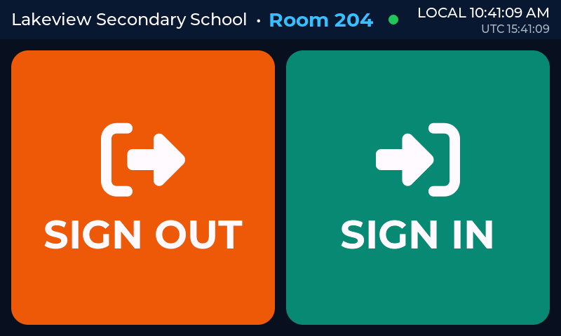
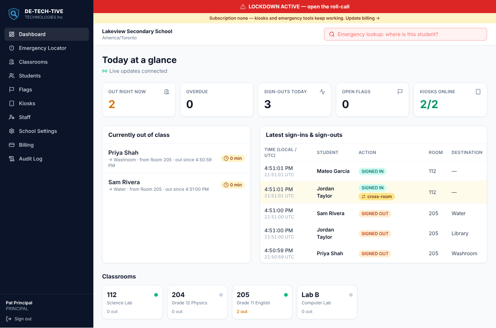
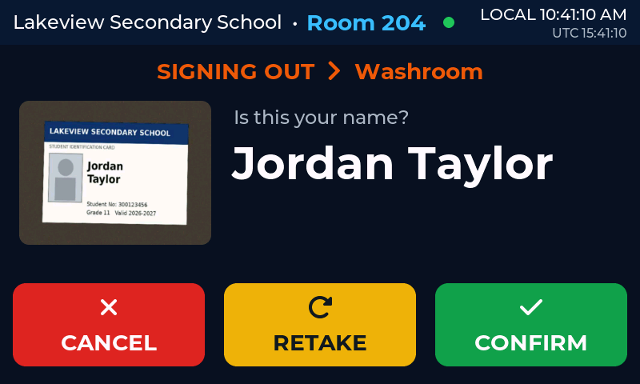
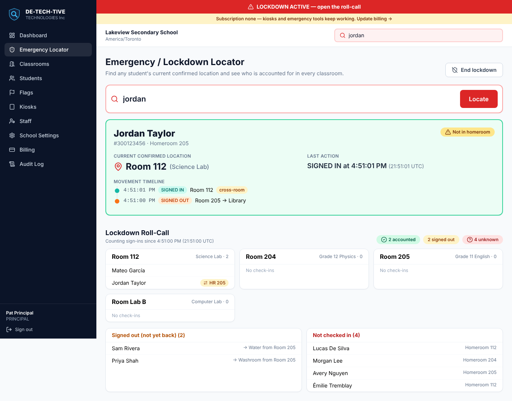

# DE-TECH-TIVE TECHNOLOGIES Inc
### Classroom Accountability, Lockdown Location Tracking & School Kiosk Platform

A touchscreen kiosk beside every classroom door records student **sign-outs** (with destination) and **sign-ins** by reading the student's ID card. A central **Master/Host** server, running on a Mac Mini or behind a Cloudflare Tunnel for a whole board, turns those events into:

* a **live "who is out of class" feed** for every classroom,
* an **Emergency / Lockdown Locator**: "where is this student right now?", plus a whole-school roll-call,
* **excessive sign-out flags** that respect **medical / IEP accommodations**, and
* **Stripe billing** at **$19.99 / month per school**. Billing status never disables sign-ins or emergency tools.

| Kiosk (ESP32-S3, 800×480) | Staff portal |
|---|---|
|  |  |
|  |  |

The kiosk screenshots are rendered from the **real firmware UI code** by the desktop simulator (`firmware/sim`). All 16 kiosk screens are in [`docs/screenshots/`](docs/screenshots).

---

## Architecture

```
 Classroom (Slave)                                   Master / Host (Mac Mini, macOS)
┌───────────────────────────────┐   HTTPS + X-Device-Token   ┌───────────────────────────────────────────┐
│ Waveshare ESP32-S3-Touch-LCD-7 │ ─────────────────────────▶ │ FastAPI (Python 3.11+)                    │
│  • LVGL 8.3 UI, state machine  │  /kiosk/scan-card (JPEG)   │  • OpenCV card detect + perspective warp   │
│  • USB UVC webcam (OTG)        │  /kiosk/events (+batch)    │  • OCR: PaddleOCR › EasyOCR › Tesseract    │
│  • NTP clocks LOCAL + UTC      │  /kiosk/heartbeat          │  • roster fuzzy match / auto-registration  │
│  • NVS offline event queue     │ ◀───────────────────────── │  • flag engine + exemptions                │
│  • setup wizard + pairing      │   config, lockdown state   │  • RBAC, Argon2id, JWT, TOTP, audit log    │
└───────────────────────────────┘                            │  • Stripe Checkout / Portal / Webhooks     │
                                                             │ PostgreSQL (or SQLite with one .env flag)  │
 Staff (desktop / tablet / phone)   HTTPS + WebSocket        │ React + Vite + Tailwind portal (same host) │
 ──────────────────────────────────────────────────────────▶ └───────────────────────────────────────────┘
```

## Repository layout

```
backend/    FastAPI API, OCR pipeline, flag engine, Stripe, Alembic migrations, pytest suite
frontend/   React 18 + Vite + Tailwind staff portal (served by the backend in production)
firmware/   ESP-IDF 5.3 + LVGL 8.3 kiosk firmware (PlatformIO); firmware/sim = desktop UI simulator
deploy/     macOS installer + launchd agent, backups, Cloudflare Tunnel, Postgres compose file
docs/       DEPLOYMENT · FIRMWARE · SECURITY · API · TESTING · screenshots
```

## 60-second quickstart (Mac Mini, SQLite)

```bash
brew install python@3.12 node@20 tesseract
cd backend && ./run.sh                       # creates .venv, .env, runs migrations, starts :8000
# first SUPERSUDO password -> backend/data/INITIAL_ADMIN_PASSWORD.txt
.venv/bin/python scripts/seed_demo.py         # (2nd terminal, in backend/) optional demo school, staff, roster
cd ../frontend && npm ci && npm run build    # the backend now serves the portal at http://<mac-ip>:8000
```

For production (PostgreSQL, launchd auto-start, HTTPS through Cloudflare Tunnel, Stripe), see **[docs/DEPLOYMENT.md](docs/DEPLOYMENT.md)**. To flash the kiosks, see **[docs/FIRMWARE.md](docs/FIRMWARE.md)**.

## Kiosk flow

`BOOT_SPLASH` (3.5 s) → `SETUP_WIZARD` (Welcome → Language EN/FR/ES → Wi-Fi scan/connect → `XXXX-XXXX` + QR pairing) → `HOME` (**SIGN OUT** / **SIGN IN**) → `SIGNOUT_SELECT` (6 school-configurable destinations) → `CAMERA_SCAN` (live preview, 2–3 frames/s to OCR) → `CONFIRM_IDENTITY` (**CANCEL** red / **RETAKE** yellow / **CONFIRM** green) → `SUCCESS_FEEDBACK` (auto-return after 3.0 s).

Extras beyond the base spec, added for crisis resilience:
* **Manual name entry** appears when the card reader or host is unreachable, or after 8 s without a read. These events are marked `MANUAL` in the portal.
* The **offline queue** keeps each event's original NTP timestamp and an idempotency key, and replays events in chronological order.
* **Lockdown mode** turns every kiosk's top bar red ("LOCKDOWN — SIGN IN HERE") and drives the roll-call.
* A **hidden 5-second press** on the clocks opens diagnostics (IP, RSSI, firmware, queue depth, camera). Re-pair and factory reset require the room-admin PIN, which the server verifies.

## Tests

```bash
cd backend && pip install -r requirements-dev.txt && pytest          # 33 tests: SQLite (default)
TEST_DATABASE_URL=postgresql+asyncpg://u:p@localhost/db pytest       # same suite on PostgreSQL
cd frontend && npm run build                                         # strict TypeScript build
cmake -S firmware/sim -B build-sim && cmake --build build-sim && ./build-sim/kiosk_sim out/   # kiosk UI screenshots
cd firmware && pio run -e kiosk-mock-camera                          # firmware build (needs PlatformIO registry access)
```

See [docs/TESTING.md](docs/TESTING.md) for what each layer covers and an end-to-end bench test with a mock camera.
